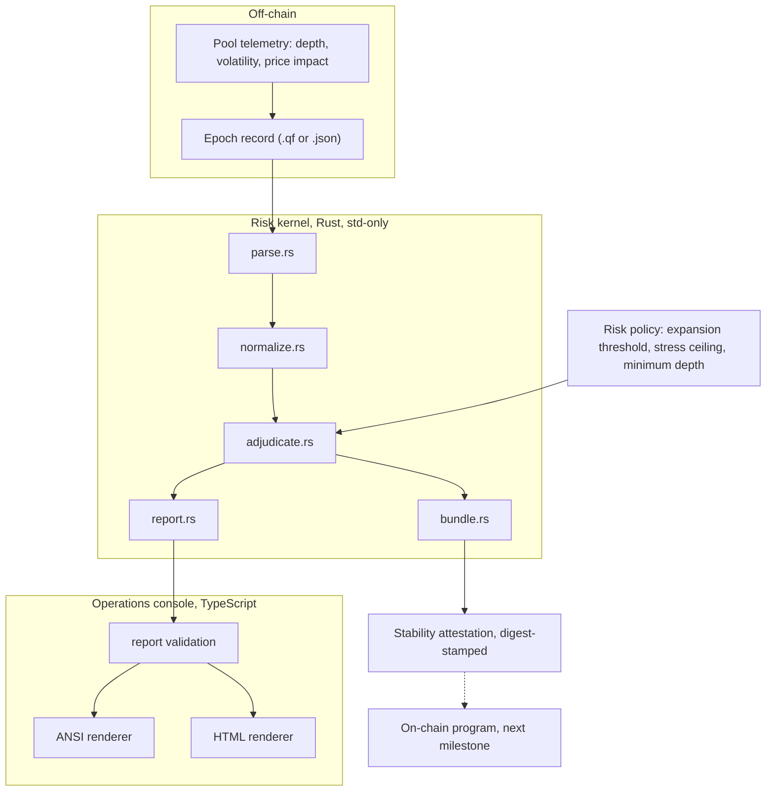
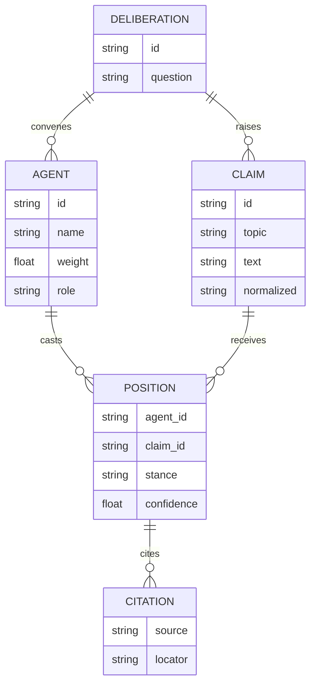
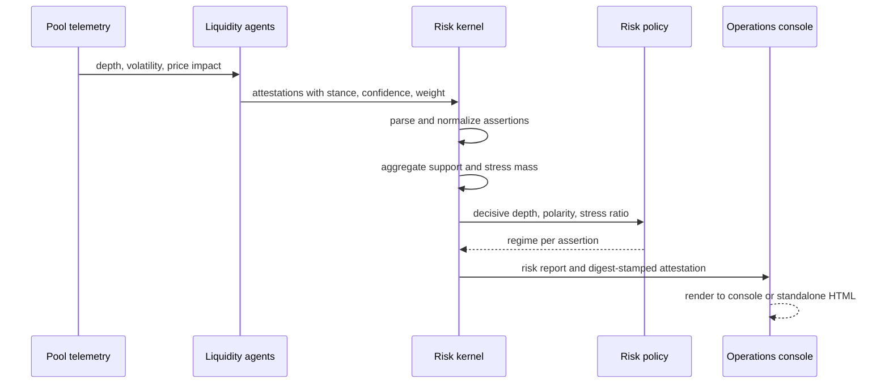
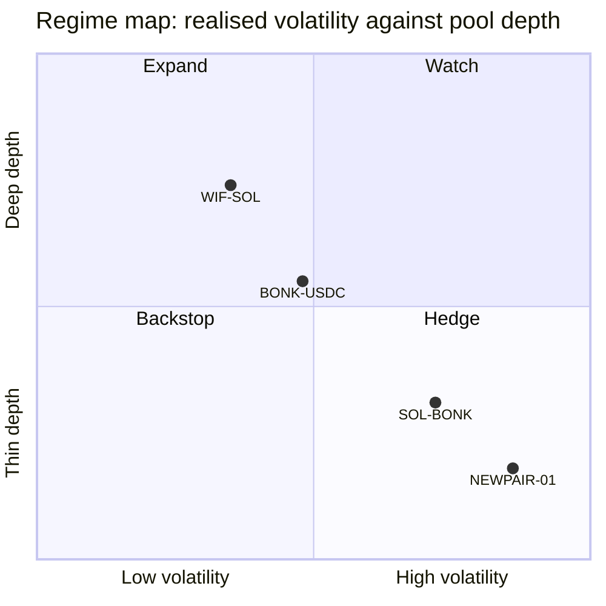
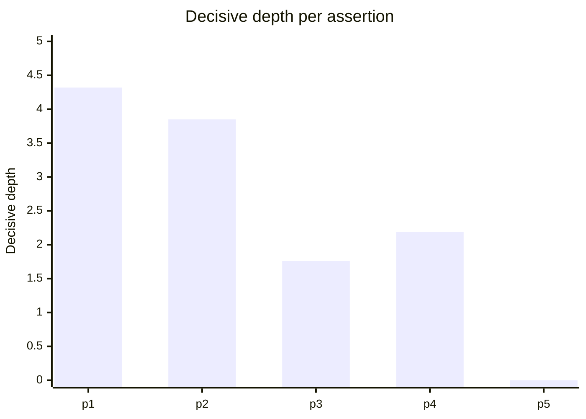
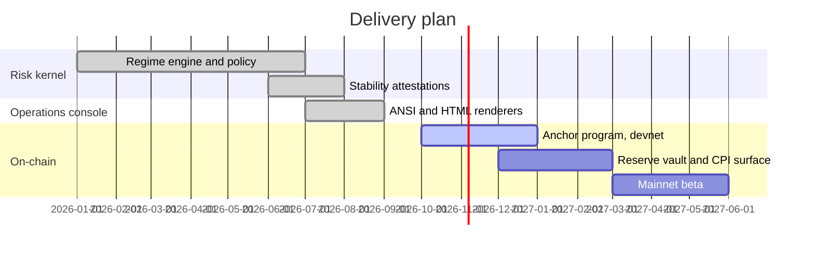

# Solana Stability Protocol (SSP)

[](https://www.rust-lang.org)
[](https://www.typescriptlang.org)
[](#properties)
[](LICENSE)

SSP is liquidity infrastructure for Solana memecoin markets. It adjusts liquidity
distribution, trading fees and capital allocation in response to volatility, pool
depth and market conditions. A reserve backstop can deploy capital into pools
whose depth falls below a threshold, which reduces price impact during sell
pressure.

SSP does not peg prices and does not claim to prevent drawdowns. The objective is
that pool depth responds to conditions instead of staying fixed.

**Status.** The risk kernel and the operations console are implemented and
tested. The on-chain Anchor program is not written yet and is listed in the
roadmap.

## Contents

- [Mechanism](#mechanism)
- [System architecture](#system-architecture)
- [Data model](#data-model)
- [Epoch lifecycle](#epoch-lifecycle)
- [Regime classification](#regime-classification)
- [Risk policy](#risk-policy)
- [Attestations](#attestations)
- [Quick start](#quick-start)
- [CLI reference](#cli-reference)
- [Repository layout](#repository-layout)
- [Testing](#testing)
- [Properties](#properties)
- [Limitations](#limitations)
- [Roadmap](#roadmap)

## Mechanism

A set of liquidity agents attests to the state of each supported pool. Each agent
carries a capital weight. Agents submit one of three stances on each pool
assertion:

| Stance | Meaning |
| --- | --- |
| `healthy` | The agent asserts the pool state holds. |
| `stressed` | The agent asserts the pool state fails. |
| `abstain` | The agent has no signal. Recorded, carries no weight. |

The risk kernel aggregates the attestations into one liquidity regime per pool
assertion. The regime determines the action applied to the pool.

| Regime | Condition | Action |
| --- | --- | --- |
| `EXPAND` | Broad agreement, low stress. | Add depth, reduce fee, release reserve. |
| `WATCH` | Directional lean below the expansion bar. | Hold allocation, skew fee toward the lean. |
| `HEDGE` | Meaningful weight on both sides. | Rebalance inventory, raise fee. |
| `BACKSTOP` | Insufficient decisive signal. | Deploy reserve capital as a floor. |

`BACKSTOP` is a result, not an error path. An assertion with no decisive signal
is a distinct finding from an assertion that fails.

## System architecture



The kernel does not run agents, does not call models and does not touch the
network. It reads a recorded epoch and derives a result. Identical telemetry and
identical attestations produce identical regimes, identical report bytes and an
identical attestation digest.

## Data model



`weight` defaults to `1.0`. `confidence` is clamped to `[0, 1]`. A position that
references an undeclared agent or claim is rejected at validation, so a typo
cannot silently drop a vote.

## Epoch lifecycle



## Regime classification

Every non-abstaining attestation casts a signed vote:

```text
vote = sign(stance) * capital_weight * oracle_confidence
```

where `sign(healthy) = +1` and `sign(stressed) = -1`. Let `S` be the sum of
healthy votes and `C` the sum of stressed magnitudes. Then:

```text
decisive_depth  = S + C
regime_polarity = (S - C) / decisive_depth      in [-1, +1]
stress_ratio    = min(S, C) / decisive_depth    in [0, 0.5]
```

`regime_polarity` is the direction of the lean. `decisive_depth` is the capital
behind the call. `stress_ratio` is the share of that capital on the losing side.

The classifier reads those three values against the risk policy:

- `BACKSTOP` when `decisive_depth <= minimum_depth`
- `EXPAND` when `|regime_polarity| >= expansion_threshold` and `stress_ratio < stress_ceiling`
- `HEDGE` when `stress_ratio >= stress_ceiling`
- `WATCH` otherwise


The epoch also produces one scalar, the Stability Index, in `[0, 1]`. It is the
depth-weighted mean of `|regime_polarity|` across assertions. A set of agents that
agrees on heavily attested assertions scores near `1.0`. An evenly divided one
scores near `0`.

### Worked example

Two agents attest to one assertion. Agent `vlt`, capital weight `1.5`, attests
`healthy` at confidence `0.8`. Agent `rsk`, weight `1.0`, attests `stressed` at
confidence `0.6`.

```text
S = 1.5 * 0.8 = 1.20
C = 1.0 * 0.6 = 0.60
decisive_depth  = 1.80
regime_polarity = (1.20 - 0.60) / 1.80 = +0.333
stress_ratio    =  0.60 / 1.80         =  0.333
```

With the default policy (`expansion_threshold = 0.66`, `stress_ceiling = 0.34`),
`stress_ratio 0.333` is below the ceiling so the result is not `HEDGE`, and
`|polarity| 0.333` is below the threshold so it is not `EXPAND`. The regime is
`WATCH`, leaning healthy.

## Risk policy

Three parameters control classification. All are range-validated.

| Parameter | Flag | Default | Effect |
| --- | --- | --- | --- |
| `expansion_threshold` | `--consensus` | `0.66` | Required polarity to release capital. |
| `stress_ceiling` | `--dissent` | `0.34` | Losing-side share that forces a hedge. |
| `minimum_depth` | `--min-mass` | `~0` | Decisive depth required to act at all. |

The defaults encode a two-thirds supermajority rule with a limited stress
tolerance. Raising the threshold makes expansion rarer. Lowering the ceiling
makes hedging more frequent.



## Attestations

An attestation is a canonical snapshot of an epoch together with its regimes,
stamped with a content digest (FNV-1a). Attestations are byte-stable, so they
diff cleanly and can be checked in CI before any on-chain submission.

```bash
cargo run --release -- bundle samples/pool-stress.qf -o attestation.json
cargo run --release -- verify attestation.json
```

The digest covers the canonical body with a fixed key order, positions sorted by
`(assertion, agent, stance)` and floats snapped to six decimals. The snap makes
the JSON writer idempotent, so a bundle survives a parser round trip without
changing its digest. Any mutation makes `verify` exit with code `4`.

## Quick start

Requires Rust 1.74 or newer. The console additionally requires Node.js 18 or
newer. No other toolchain is needed.

```bash
cargo build --release
cargo test
cargo run --release -- adjudicate samples/pool-stress.qf
```

The last command prints a risk report:

```text
========================================================================
SSP RISK REPORT  ::  pool-stress
Question: Does SOL-BONK hold depth above $250k under a 15% drawdown?
========================================================================
Assertions: 5   Expand: 1   Hedge: 1   Watch: 2   Backstop: 1
Stability index: 58.7%   Policy: expand>=0.66, stress<0.34
------------------------------------------------------------------------
[=] [p1] Pool depth stays above $250k through the drawdown.
     expand/healthy topic=depth  polarity=+1.00  depth=4.32  stress=0%  cites=1
[!] [p2] A $10k sell moves price by less than 1.5%.
     hedge/stressed topic=impact  polarity=-0.24  depth=3.85  stress=38%  cites=1
     dissenting: lzr, mm1
...
```

Decisive depth per assertion in the same record:



`p5` has zero decisive depth because every attestation abstained, so it is
classified `BACKSTOP`.

### Operations console

```bash
cd viewer && npm install && npm run build && cd ..

cargo run --release -- adjudicate --format json samples/pool-stress.qf \
  | node viewer/dist/cli.js -

cargo run --release -- adjudicate --format json samples/pool-stress.qf \
  | node viewer/dist/cli.js --html - -o risk.html
```

The HTML renderer inlines all styling. No remote fonts, scripts or images, so
the output opens offline and can be committed as a build artifact.

## CLI reference

```text
quorumforge <command> [options] <record-file | ->

COMMANDS
  adjudicate   Parse, normalize and print a risk report (text or json).
  bundle       Emit a digest-stamped stability attestation.
  verify       Re-derive an attestation digest and confirm it.
  inspect      Print the parsed, normalized epoch record as JSON.
  help         Print usage.

OPTIONS
  --format <text|json>   Report format for adjudicate. Default: text.
  --consensus <0..1>     Expansion threshold. Default: 0.66.
  --dissent <0..1>       Stress ceiling. Default: 0.34.
  --min-mass <n>         Minimum decisive depth to escape BACKSTOP.
  -o, --output <path>    Write to a file instead of stdout.
  --json                 Treat stdin or extensionless input as JSON.
```

Exit codes: `0` success, `2` usage error, `3` parse or validation error, `4`
digest mismatch. These make the tool usable as a CI gate.

## Repository layout

```text
src/                  Rust risk kernel, standard library only
  lib.rs              public API and the end-to-end run
  model.rs            Agent, Claim, Position, Citation, Deliberation
  json.rs             compact idempotent JSON codec
  parse.rs            line-oriented .qf parser and JSON parser
  normalize.rs        assertion canonicalization and clustering
  adjudicate.rs       weighted regime engine and policy
  bundle.rs           deterministic digest-stamped attestations
  report.rs           text and JSON report renderers
tests/                integration tests
viewer/               TypeScript operations console
samples/              example epoch records
docs/EVIDENCE.md      normative record format reference
```

Protocol vocabulary maps to code as follows.

| Protocol concept | Code |
| --- | --- |
| Liquidity agent and capital weight | `Agent { weight }` |
| Pool assertion | `Claim` |
| Attestation | `Position { stance, confidence }` |
| Liquidity regime | `Outcome` |
| Risk policy | `Policy` |
| Stability Index | `Adjudication.cohesion` |
| Stability attestation | `Bundle` and FNV-1a digest |
| Risk report | `quorumforge.report.v1` |
| Operations console | `qf-view` |

The crate and the report schema keep the internal name `quorumforge`. The report
headline also uses the words `Claims` and `cohesion`; these are the kernel's
original field names for pool assertions and the Stability Index.

## Testing

```bash
cargo test
cd viewer && npm test
make test
```

The Rust suite covers all four regimes, weight and confidence scaling, policy
tuning, parser error paths, JSON round-trip stability including unicode escapes
and surrogate pairs, attestation determinism and tamper detection. The console
suite covers report validation, colored against plain output, HTML escaping and
render determinism.

## Properties

- **Deterministic.** Ordered maps, sorted positions, snapped floats and an
  idempotent writer. Same input, same bytes.
- **No runtime dependencies.** The Rust crate uses `std` only. The console's
  single build-time dependency is the TypeScript compiler.
- **Auditable.** Every intermediate value is kept in the report, so any regime
  can be re-derived by hand.
- **Offline.** No network calls, no remote assets, no telemetry.

## Limitations

- Normalization is lexical. Assertions that share no words but mean the same
  thing are treated as distinct. There is no embedding or entailment step.
- Citations are counted, not graded. A proof and a hunch count the same.
- Confidence is self-reported. The kernel cannot detect overconfidence.
- Capital weights are supplied by the caller and never learned.
- Positions are treated as independent. Collusion and duplicated reasoning are
  not detected.
- An epoch is a static snapshot. There is no multi-round rebuttal.
- Arithmetic is `f64` snapped to six decimals, not exact rationals.
- The FNV-1a digest is an integrity fingerprint, not a cryptographic hash.
- Nothing is on-chain yet.

## Roadmap



## Record format

Two encodings are accepted and are information-equivalent. The line-oriented
`.qf` format is built for humans and version control: comments, one record per
line, readable diffs. The JSON format is built for machine generation. The full
grammar and schema are in [`docs/EVIDENCE.md`](docs/EVIDENCE.md).

## License

MIT. See [`LICENSE`](LICENSE) and [`CHANGELOG.md`](CHANGELOG.md).
