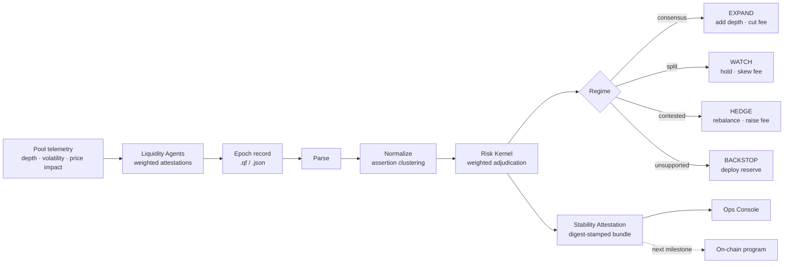
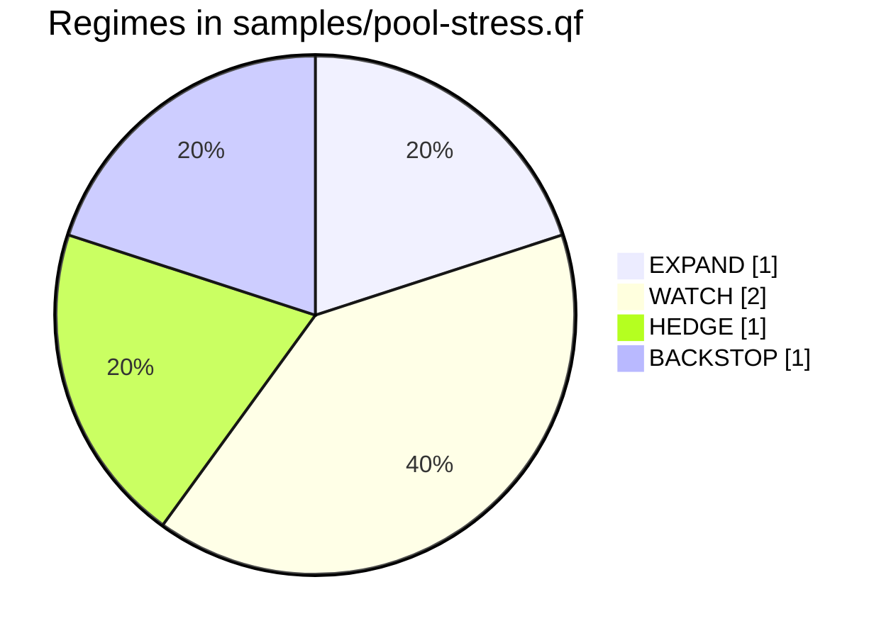
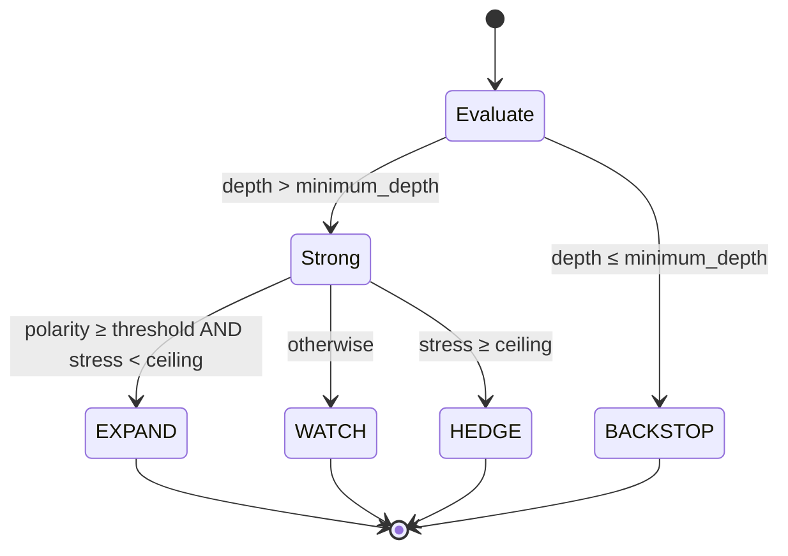
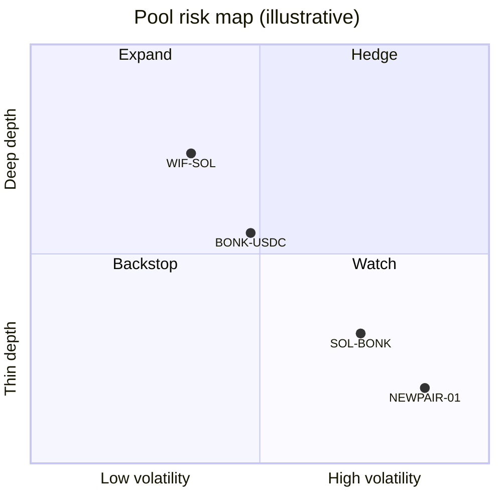

<div align="center">

# ✦ SSP ✦

### _Solana Stability Protocol_

**Liquidity that bends, not breaks.**

[](https://www.rust-lang.org)
[](https://www.typescriptlang.org)
[](#design-commitments)
[](https://github.com/haebibisimax/solana-stability-protocol/actions)
[](LICENSE)

[What it is](#what-ssp-is) · [How it works](#how-it-works) · [Regimes](#the-stability-prism) · [Quick start](#quick-start) · [Mapping](#protocol--code) · [Limitations](#limitations)

</div>

---

> **Status:** the risk kernel and ops console are complete and tested. The
> on-chain Anchor program is the next milestone — see the [roadmap](#roadmap).

## What SSP is

**SSP is a liquidity infrastructure protocol designed to make Solana memecoin
markets more resilient through an adaptive, self-adjusting liquidity system.**

At the core is an *adaptive liquidity pool* that dynamically adjusts liquidity
distribution, trading fees, and capital allocation in response to volatility,
pool depth, and market conditions. Paired with an *automated liquidity backstop*,
the protocol can deploy reserve capital when supported pools become dangerously
thin — absorbing sell pressure and reducing price impact.

The bigger vision is a **shared stability layer for Solana memecoins**: adaptive
AMM mechanics, automated liquidity rebalancing, cross-pool capital allocation,
and risk-controlled liquidity support in one protocol.

SSP does not promise to peg prices or prevent crashes. It aims to make markets
*structurally* more resilient by adapting liquidity to changing conditions.

### The mechanism, in one breath

A council of **Liquidity Agents** — each carrying a *capital weight* — attest to
the state of every supported pool. A deterministic risk kernel converts the
recorded attestations into a single **liquidity regime** per pool assertion:
`EXPAND`, `WATCH`, `HEDGE`, or `BACKSTOP`. The regime drives how depth, fees and
reserve capital are redistributed. Nothing about the decision is opaque: every
intermediate quantity is retained so a human can re-derive the verdict with a
pocket calculator.

---

## How it works



**Four stages, no orchestration.** The kernel never runs agents, never calls
models, never touches the network. It reads a *record* of attestations and
derives a verdict. That separation is the whole point: identical telemetry and
identical attestations always yield identical regimes, identical report bytes,
and an identical attestation digest.

[](docs/assets/council-prism.svg)

---

## The stability prism

A pile of agent opinions feels like noise until you separate it by direction and
strength. The prism has exactly four exit angles, and every pool assertion leaves
through exactly one of them.

| Regime | Glyph | Meaning | Protocol action |
| --- | :-: | --- | --- |
| **EXPAND** | ◆ | Strong, low-stress agreement. | Add depth, reduce fee, release reserve. |
| **WATCH** | ◈ | A real lean, below the expansion bar. | Hold allocation, skew fee toward the lean. |
| **HEDGE** | ▲ | Meaningful weight on *both* sides. | Rebalance, raise fee, hedge inventory. |
| **BACKSTOP** | ○ | Too little decisive signal to act. | Deploy reserve capital as a floor. |

`BACKSTOP` is not a failure mode — it is a finding. Knowing a pool has *no*
decisive signal is often as valuable as knowing it is healthy.



---

## The math

Every non-abstaining attestation casts a **signed vote**:

```text
vote = sign(stance) · capital_weight · oracle_confidence
```

with `sign(healthy) = +1` and `sign(stressed) = −1`. Confidence is clamped to
`[0, 1]` defensively. Sum healthy votes into `S` and stressed magnitudes into
`C`, then:

```text
decisive_depth = S + C
regime_polarity = (S − C) / decisive_depth      ∈ [−1, +1]
stress_ratio    = min(S, C) / decisive_depth    ∈ [0, 0.5]
```

`regime_polarity` is *which way* the market leans; `decisive_depth` is *how much
capital is behind the call*; `stress_ratio` is *how much of it disagrees*.

The classifier reads those three numbers against a **risk policy**:

- **BACKSTOP** if `decisive_depth ≤ minimum_depth`
- **EXPAND** if `|regime_polarity| ≥ expansion_threshold` **and** `stress_ratio < stress_ceiling`
- **HEDGE** if `stress_ratio ≥ stress_ceiling`
- **WATCH** otherwise

The epoch then earns a single **Stability Index (SSI)** in `[0, 1]`: the
depth-weighted average of each assertion's `|regime_polarity|`. A council that
agrees loudly on heavy assertions scores near `1.0`; an evenly split one near `0`.



### Worked micro-example

Two agents attest to one assertion. Agent `vlt` (capital weight `1.5`) attests
*healthy* at confidence `0.8`; agent `rsk` (weight `1.0`) attests *stressed* at
confidence `0.6`.

```text
S = 1.5 · 0.8 = 1.20        C = 1.0 · 0.6 = 0.60
decisive_depth = 1.80
regime_polarity = (1.20 − 0.60) / 1.80 = +0.333
stress_ratio    = 0.60 / 1.80          =  0.333
```

Under the default policy (`expansion_threshold = 0.66`, `stress_ceiling = 0.34`):
`stress_ratio 0.333 < 0.34` so it is not a hedge; `|polarity| 0.333 < 0.66` so
it is not an expansion. The regime is **WATCH, skewed healthy**.

---

## Quick start

You need a Rust toolchain (1.74+) and — for the ops console — Node.js 18+.
Nothing else. There is no runtime dependency on either side.

```bash
# 1. Build and test the risk kernel.
cargo build --release
cargo test

# 2. Adjudicate an epoch record as a console risk report.
cargo run --release -- adjudicate samples/pool-stress.qf
```

Output looks like:

```text
========================================================================
SSP RISK REPORT  ::  pool-stress
Question: Does SOL-BONK hold depth above $250k under a 15% drawdown?
========================================================================
Assertions: 5   Expand: 1   Hedge: 1   Watch: 2   Backstop: 1
Stability Index: 58.7%   Policy: expand>=0.66, stress<0.34
------------------------------------------------------------------------
[=] [p1] Pool depth stays above $250k through the drawdown.
     expand/healthy topic=depth  polarity=+1.00  depth=4.32  stress=0%  ...
[!] [p2] A $10k sell moves price by less than 1.5%.
     hedge/stressed topic=impact  polarity=-0.24  depth=3.85  ...
     dissenting: lzr, mm1
...
```

### Ops console

```bash
cd viewer && npm install && npm run build && cd ..

# Live ANSI console digest.
cargo run --release -- adjudicate --format json samples/pool-stress.qf \
  | node viewer/dist/cli.js -

# Standalone, fully offline HTML risk page.
cargo run --release -- adjudicate --format json samples/pool-stress.qf \
  | node viewer/dist/cli.js --html - -o risk.html
```

The HTML renderer inlines **all** styling — no remote fonts, scripts or images —
so it opens offline and can be committed as an artifact.

### CLI reference

```text
quorumforge <command> [options] <record-file | ->

COMMANDS
  adjudicate   Parse, normalize, and print a risk report (text or json).
  bundle       Emit a deterministic, digest-stamped stability attestation.
  verify       Re-derive an attestation digest and confirm it.
  inspect      Print the parsed, normalized epoch record as JSON.
  help         Show usage.

OPTIONS
  --format <text|json>   Report format for `adjudicate` (default: text).
  --consensus <0..1>     Expansion threshold (default: 0.66).
  --dissent <0..1>       Stress ceiling (default: 0.34).
  --min-mass <n>         Minimum decisive depth to escape backstop.
  -o, --output <path>    Write to a file instead of stdout.
  --json                 Treat stdin / extensionless input as JSON.
```

Exit codes: `0` success, `2` usage error, `3` parse error, `4` digest mismatch —
friendly to CI gates.

---

## Risk policy

Three knobs govern classification. All are validated to sensible ranges.

| Knob | Flag | Default | Effect |
| --- | --- | :-: | --- |
| `expansion_threshold` | `--consensus` | `0.66` | How lopsided a lean must be to release capital. |
| `stress_ceiling` | `--dissent` | `0.34` | How much losing-side capital tips a pool into hedging. |
| `minimum_depth` | `--min-mass` | `~0` | How much decisive capital is needed to act at all. |

Defaults encode a conservative rule of thumb: **a two-thirds supermajority with
limited stress justifies expansion.** Raise the threshold to make the council
harder to satisfy; lower the ceiling to flag division sooner.



---

## Stability attestations

An **attestation** is a canonical, self-contained snapshot of an epoch *and* its
regimes, stamped with a content digest (dependency-free FNV-1a). Attestations are
byte-stable — the same inputs always produce the same bytes — so they diff
cleanly and can be checksummed in CI before ever touching a chain.

```bash
cargo run -- bundle samples/pool-stress.qf -o attestation.json
cargo run -- verify attestation.json      # -> "digest OK: ..."
```

The digest covers the compact canonical body with fixed key order, positions
sorted by `(assertion, agent, stance)`, and floats snapped to a six-decimal grid.
That last detail is load-bearing: it makes the writer idempotent, so a bundle
survives a parser round trip without changing its digest. Mutate any field and
`verify` exits `4`.

---

## Protocol → code

Everything above maps one-to-one onto shipped, tested code. The crate is
internally named `quorumforge`; that is the kernel's codename.

```text
src/                      Rust risk kernel (std library only)
├── lib.rs                public API and the end-to-end `run`
├── model.rs              Agent / Claim / Position / Deliberation
├── json.rs               a compact, idempotent JSON codec
├── parse.rs              line-oriented (.qf) and JSON parsers
├── normalize.rs          assertion canonicalization + clustering
├── adjudicate.rs         the weighted regime engine
├── bundle.rs             deterministic, digest-stamped attestations
└── report.rs             text + JSON report renderers

tests/                    focused integration tests
viewer/                   TypeScript ops console (dependency-light)
samples/                  epoch records (.qf and .json)
docs/EVIDENCE.md          normative record-format reference
docs/assets/              prism + dissent-map animations
```

| Protocol concept | Code |
| --- | --- |
| Liquidity Council | `Deliberation.agents` |
| Liquidity Agent + capital weight | `Agent { weight }` |
| Pool State Assertion | `Claim` |
| On-chain attestation | `Position { stance, confidence }` |
| Liquidity Regime | `Outcome` |
| Risk Policy | `Policy` |
| Stability Index | `Adjudication.cohesion` |
| Stability Attestation | `Bundle` + FNV-1a digest |
| Risk Report | `quorumforge.report.v1` |
| Ops Console | `qf-view` |

---

## Testing

```bash
cargo test                      # unit, integration, doctests
cd viewer && npm test           # renderer suite
make test                       # everything
```

The Rust suite covers all four regimes, weight and confidence scaling, policy
tuning, parser error paths, JSON round-trip stability (unicode escapes,
surrogate pairs), attestation determinism, and tamper detection. The console
suite covers report validation, ANSI vs. plain output, HTML escaping, and render
determinism.

---

## Design commitments

- **No orchestration.** The kernel judges a record; it never runs agents.
- **No dependencies.** Rust core is std-only; the console's only build-time
  dependency is `tsc`.
- **Determinism first.** Ordered maps, sorted positions, snapped floats,
  idempotent writer — identical inputs, identical bytes.
- **Auditability over cleverness.** Every intermediate quantity is retained in
  the report so a human can check the math.
- **Offline forever.** No network calls, no remote media, no telemetry.

---

## Limitations

SSP is intentionally narrow. Know the edges before you rely on it.

- **No semantic understanding.** Assertion normalization is lexical only — it
  folds hedges and contractions and collapses whitespace. Two assertions that
  *mean* the same but share no words stay distinct.
- **No provenance grading.** Citations are counted, not judged. A rigorous proof
  and a hunch count the same. Weight your agents, not your sources.
- **Confidence is self-reported.** The kernel trusts (after clamping) declared
  confidence; it cannot detect overconfidence or calibration drift.
- **Capital weights are exogenous.** Garbage weights yield garbage regimes.
- **Independence is assumed.** No collusion detection, no duplicated-reasoning
  detection.
- **Single-epoch.** A record is a static snapshot; no rebuttal rounds.
- **`f64` snapped to six decimals.** Ample for adjudication, not
  arbitrary-precision.
- **FNV-1a is an integrity fingerprint, not a security hash.**
- **Not yet on-chain.** Today the kernel runs off-chain; the Anchor program,
  reserve vault and CPI interface are the next milestone.

---

## Roadmap


---

## Record format

The line-oriented `.qf` format is built for humans and version control:
comments, one record per line, clean diffs. The JSON format is built for
machines that generate epochs programmatically. They are information-equivalent
and converge on the same model. Full grammar lives in
[`docs/EVIDENCE.md`](docs/EVIDENCE.md).

[](docs/assets/dissent-map.svg)

---

## License

Released under the [MIT License](LICENSE). See [`CHANGELOG.md`](CHANGELOG.md).

_Bring the market. SSP brings the light._
